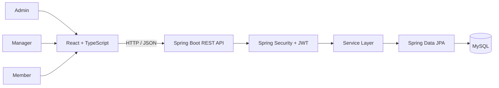

<div align="center">

# ✅ Task Management System

### A Role-Based Platform for Organizing Projects, Managing Tasks, and Tracking Team Productivity

A full-stack task management application with project organization, task assignment, role-based access, dashboards, notifications, and reporting.

[](https://www.java.com/)
[](https://spring.io/projects/spring-boot)
[](https://react.dev/)
[](https://www.typescriptlang.org/)
[](https://www.mysql.com/)
[](https://jwt.io/)
[](https://maven.apache.org/)

</div>

---

## 📌 Overview

The **Task Management System** is a full-stack web application designed to help teams organize work, manage projects, assign tasks, and monitor progress through a centralized platform.

It follows a role-based workflow with three main user types:

- **Admin** — manages users and has administrative control over the platform.
- **Manager** — manages projects, creates and assigns tasks, and monitors team progress.
- **Member** — views assigned work, updates task progress, and manages personal profile/settings.

The backend is built with Java and Spring Boot, exposing REST APIs secured with Spring Security and JWT. The frontend is built with React and TypeScript and communicates with the backend through HTTP APIs.

## ✨ Features

### 🔐 Authentication & Authorization
- User registration and login.
- JWT-based authentication.
- Password hashing with BCrypt.
- Stateless security configuration.
- Role-based access control for Admin, Manager, and Member.
- Protected API endpoints.

### 📁 Project Management
- Create, view, update, and delete projects.
- Search projects by query.
- Organize tasks under projects.
- Restrict project management actions based on role.

### 📝 Task Management
- Create, view, update, and delete tasks.
- Assign tasks to team members.
- Track task status and priority.
- Manage due dates.
- Filter tasks by user, project, status, priority, and date range.
- Search tasks using a query.
- Paginated task listing.
- Role-aware task operations.

### 📊 Dashboard & Reports
- Dashboard summaries for management roles.
- Task report endpoint with filtering.
- View task information by user, project, status, priority, and due date.

### 🔔 Notifications
- Retrieve notifications for the authenticated user.
- Identify overdue tasks.
- Identify tasks due soon.
- Show upcoming assigned tasks.

### 👤 User Profile & Settings
- View and update the authenticated user's profile.
- Upload/update profile avatar.
- Change account password.
- Retrieve and update user settings.
- Admin-level user management.

### 📘 API Documentation
- OpenAPI/Swagger integration.
- Interactive API documentation when the backend is running.

## 👥 Roles & Permissions

| Capability | Admin | Manager | Member |
|---|:---:|:---:|:---:|
| View projects | ✅ | ✅ | ✅ |
| Create/update/delete projects | ✅ | ✅ | ❌ |
| View tasks | ✅ | ✅ | ✅ |
| Create tasks | ✅ | ✅ | ❌ |
| Update tasks | ✅ | ✅ | ✅* |
| Delete tasks | ✅ | ✅ | ❌ |
| View dashboard | ✅ | ✅ | ❌ |
| View reports | ✅ | ✅ | ✅** |
| Manage users | ✅ | ✅ (view) | ❌ |
| Update own profile/settings | ✅ | ✅ | ✅ |

\* Task update is exposed to all three roles; service-level rules determine what a member may change.

\** The report endpoint permits all three roles, while the dashboard endpoint is restricted to Admin and Manager.

## 🏗️ Architecture



### Typical Request Flow

1. A user registers or logs in through the frontend.
2. The backend authenticates the credentials and returns an authentication response containing a JWT.
3. The frontend includes the token in the `Authorization` header for protected requests.
4. The JWT authentication filter validates the token and establishes the security context.
5. Controllers delegate business operations to service classes.
6. Services use Spring Data JPA repositories to access MySQL.
7. The backend returns JSON responses to the frontend.

## 🧰 Technology Stack

| Layer | Technologies |
|---|---|
| Frontend | React 18, TypeScript, Vite |
| UI | Radix UI, Tailwind CSS, Lucide React, Motion |
| Backend | Java 17, Spring Boot 3.3.2 |
| REST API | Spring Web |
| Security | Spring Security, JWT (JJWT), BCrypt |
| Persistence | Spring Data JPA, Hibernate |
| Database | MySQL |
| Validation | Spring Boot Validation |
| API Documentation | Springdoc OpenAPI / Swagger UI |
| Build Tool | Maven |
| Frontend Package Manager | npm |
| Testing | Spring Boot Starter Test, Spring Security Test |

## 📂 Project Structure

```text
Task-Management-System/
│
├── backend/
│   ├── src/main/java/com/taskmanager/
│   │   ├── config/          # JWT and Spring Security configuration
│   │   ├── controller/      # REST API controllers
│   │   ├── dto/             # Request and response objects
│   │   ├── entity/          # JPA entities and enums
│   │   ├── exception/       # Custom exceptions and global handler
│   │   ├── repository/      # Spring Data JPA repositories
│   │   ├── security/        # JWT filter and user details service
│   │   └── service/         # Business logic
│   ├── src/main/resources/
│   │   └── schema-reference.sql
│   ├── scripts/
│   │   └── runtime-demo.sh
│   ├── README.md
│   └── pom.xml
│
├── frontend/
│   ├── src/
│   │   ├── app/
│   │   │   ├── components/
│   │   │   ├── contexts/
│   │   │   ├── data/
│   │   │   ├── lib/
│   │   │   └── pages/
│   │   │       ├── admin/
│   │   │       ├── auth/
│   │   │       ├── manager/
│   │   │       └── member/
│   │   └── styles/
│   ├── package.json
│   └── vite.config.ts
│
└── README.md
```

## ⚙️ Getting Started

### Prerequisites

Make sure the following tools are installed:

- JDK 17
- Maven 3.8+
- Node.js 20+
- npm
- MySQL 8+

### 1. Clone the repository

```bash
git clone https://github.com/Karthi247/Task-Management-System.git
cd Task-Management-System
```

### 2. Configure MySQL

Create a database:

```sql
CREATE DATABASE task_management;
```

The backend needs a MySQL connection configuration. Check the application's configuration and set your database URL, username, and password for your local environment.

Example configuration:

```properties
spring.datasource.url=jdbc:mysql://localhost:3306/task_management
spring.datasource.username=your_mysql_username
spring.datasource.password=your_mysql_password
spring.jpa.hibernate.ddl-auto=update
```

Do not commit real database credentials or production secrets to Git.

The repository includes a schema reference at:

```text
backend/src/main/resources/schema-reference.sql
```

The backend README also documents the runtime demo and initial data setup.

### 3. Run the backend

Open a terminal:

```bash
cd backend
mvn spring-boot:run
```

The backend is configured in the project for Spring Boot 3.3.2 and Java 17.

Default API base URL:

```text
http://localhost:8080
```

### 4. Run the frontend

Open another terminal:

```bash
cd frontend
npm install
npm run dev
```

Vite will display the local development URL in the terminal (typically `http://localhost:5173`).

Make sure the frontend API configuration points to the backend URL. Update the frontend API client/configuration when using a different host or port.

## 🔌 REST API Overview

The backend controllers expose the following API groups.

### Authentication — `/api/auth`

| Method | Endpoint | Description |
|---|---|---|
| POST | `/api/auth/register` | Register a new account |
| POST | `/api/auth/login` | Authenticate and obtain a token |

### Users — `/api/users`

| Method | Endpoint | Description |
|---|---|---|
| GET | `/api/users/me` | Get current user profile |
| PUT | `/api/users/me` | Update current user profile |
| POST | `/api/users/me/avatar` | Upload/update avatar |
| POST | `/api/users/me/change-password` | Change current password |
| GET | `/api/users` | List users (Admin/Manager) |
| POST | `/api/users` | Create user (Admin) |
| PUT | `/api/users/{id}` | Update user (Admin) |
| DELETE | `/api/users/{id}` | Delete user (Admin) |

### Projects — `/api/projects`

| Method | Endpoint | Description |
|---|---|---|
| GET | `/api/projects` | List/search projects |
| POST | `/api/projects` | Create project (Admin/Manager) |
| PUT | `/api/projects/{id}` | Update project (Admin/Manager) |
| DELETE | `/api/projects/{id}` | Delete project (Admin/Manager) |

### Tasks — `/api/tasks`

| Method | Endpoint | Description |
|---|---|---|
| GET | `/api/tasks` | List tasks with filters and pagination |
| POST | `/api/tasks` | Create task (Admin/Manager) |
| PUT | `/api/tasks/{id}` | Update task |
| DELETE | `/api/tasks/{id}` | Delete task (Admin/Manager) |

Supported list filters include:

```text
GET /api/tasks
    ?userId=1
    &projectId=1
    &status=IN_PROGRESS
    &priority=HIGH
    &q=backend
    &dueFrom=2026-01-01
    &dueTo=2026-12-31
    &page=0
    &size=10
```

All filters are optional. The `page` parameter is zero-based and `size` controls the page length.

### Dashboard & Reports

| Method | Endpoint | Description |
|---|---|---|
| GET | `/api/dashboard` | Management dashboard |
| GET | `/api/reports/dashboard` | Dashboard report |
| GET | `/api/reports/tasks` | Task report with filters |

### Notifications & Settings

| Method | Endpoint | Description |
|---|---|---|
| GET | `/api/notifications` | Get current user's notifications |
| GET | `/api/settings` | Get current user's settings |
| PUT | `/api/settings` | Update current user's settings |

For request/response DTO details and exact business rules, refer to the backend source code and [backend README](backend/README.md).

## 🔐 Security

The backend includes:

- JWT authentication filter.
- Stateless Spring Security session management.
- BCrypt password encoder.
- Method-level authorization using `@PreAuthorize`.
- Role-specific API access for Admin, Manager, and Member.
- CORS configuration for frontend/backend communication.

For deployment, keep JWT signing secrets and database credentials in environment variables or a secret manager. Use HTTPS, rotate secrets appropriately, and avoid exposing seeded development credentials in a public production deployment.

## 📘 Swagger API Documentation

After starting the backend, open:

```text
http://localhost:8080/swagger-ui/index.html
```

The OpenAPI specification is available at:

```text
http://localhost:8080/v3/api-docs
```

## 🧪 Testing

Run backend tests from the backend directory:

```bash
mvn test
```

The project includes Spring Boot testing and Spring Security testing dependencies.

A backend runtime demonstration script is also available:

```bash
cd backend
./scripts/runtime-demo.sh
```

On Windows, run the script in a compatible shell or execute its login/API requests manually.

## 🛣️ Future Enhancements

Potential improvements for the project include:

- Add automated frontend and backend integration tests.
- Add Docker Compose for the frontend, backend, and MySQL database.
- Add task activity history and audit logs.
- Add real-time updates for task assignments and status changes.
- Add email notifications and scheduled reminders.
- Add attachment support for tasks and projects.
- Add CI workflow checks for tests, linting, and security scanning.
- Add production deployment documentation and environment examples.

## 👨‍💻 Author

**Karthi C**

- GitHub: [@Karthi247](https://github.com/Karthi247)
- LinkedIn: [karthi-c2470](https://www.linkedin.com/in/karthi-c2470)

---

<div align="center">

*Plan clearly. Collaborate effectively. Deliver consistently.*

</div>
